# A Comparative Analysis of Vision Transformers and Convolutional Neural Networks for Low-Resolution Image Classification

> **Research question:** *How do Vision Transformers and Residual Networks compare in classification accuracy and training performance when applied to low-resolution satellite imagery?*

Computer Science Extended Essay (IB, May 2026 session).

**TL;DR:** On the RESISC45 satellite dataset at 32×32, 64×64 and 128×128 pixels, **ResNet18 achieved the highest test accuracy at every resolution** (82.3% → 90.7%) with the lowest inference time (1.7 ms/image). Vision Transformers performed worst overall but gained the most from higher resolution (+15.1 percentage points for both ViT-Small and ViT-Base).

| | |
|---|---|
| 📓 Code | [`main.ipynb`](main.ipynb) |
| 📊 Results table | [`performance_table.csv`](performance_table.csv) |
| 📄 Full essay (PDF) | [`Extended Essay copy.pdf`](Extended%20Essay%20copy.pdf) |

---

## Table of Contents

1. [Introduction](#1-introduction)
2. [Background](#2-background)
3. [Methodology](#3-methodology)
4. [Results and Analysis](#4-results-and-analysis)
5. [Conclusion](#5-conclusion)
6. [Further Scope](#6-further-scope)
7. [Bibliography](#7-bibliography)
8. [Running the Code](#running-the-code)

---

## 1 Introduction

### 1.1 Context and Scope

In recent years, deep learning has revolutionized the field of computer vision (CV), enabling automated systems to complete tasks that previously required extensive human expertise and time. One domain that has been radically impacted by these advancements is within satellite imagery, where deep learning helps solve tasks requiring a large-scale visual analysis. Global Forest Watch, a popular deforestation tracker, has reported that it relies heavily on deep learning algorithms such as ResNets to map forest loss patterns across millions of kilometers of forest imagery. The extracted insight is then used to alert authorities when unusual deforestation activity occurs across the globe (Stanimirova et al.). While this example highlights the need for deep learning models to aid human activity, it also underscores the present risk in entrusting artificial intelligence (AI) to bear significant responsibilities. In order to prevent costly and life-threatening accidents, it is crucial that we thoroughly evaluate a chosen algorithm before deploying it in high-stakes real-world contexts. The performance of any given model is heavily influenced by factors such as the nature of the data being handled and the specific architectural design employed. Consequently, selecting the appropriate algorithm for the right task is critical in ensuring the safe use of AI models.

### 1.2 Research Question

The necessity for highly capable CV models has propagated the development of deep learning paradigms. Among these, Residual Networks (ResNets) and Vision Transformers (ViTs) have emerged as the pillars for modern image classification. While these architectures have proven to be generally effective in ideal conditions, the insight into their efficacy under constrained environments remains limited. This study will therefore investigate two variants from each architecture family, evaluating their performance among three low-resolution tiers. By analyzing classification performance, this paper aims to answer the following research question: *"How do Vision Transformers and Residual Networks compare in classification accuracy and training performance when applied to low-resolution satellite imagery?"*

### 1.3 Literature Review

Multiple studies have compared the general performance of ViTs and ResNets (Murali, Kaushik, et al., Henry, A., E. Daniel, S. Seetha, and S. Durga), concluding that ViTs excel with massive training datasets, while ResNets dominate in data-scarce environments. Nevertheless, a significant gap exists regarding how these models perform when applied to low-resolution satellite imagery. Existing research rarely addresses how reduced spatial resolution and texture-dominated images impact each architecture's ability to extract meaningful features.

---

## 2 Background

### 2.1 Neural Networks

Neural Networks (NN) are a fundamental architecture inspired by the human brain, with the primary function of producing a prediction output based on a series of inputs. They consist of interconnected layers of artificial neurons, conventionally organized as an input layer, multiple hidden layers, and one output layer. In fully connected networks, each neuron in one layer is connected to every neuron in the next, forming a network-like structure (see Figure 1).

  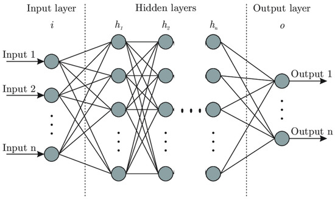 
  <em>Figure 1: Diagram of a Neural Network (Mahdi Sedighkia and Datta)</em>

Each connection between neurons is associated with a weight parameter, and each neuron with its own bias term. As data points pass through the network, a given neuron will compute the weighted sum of all previous inputs, add its bias, and apply a non-linear activation function, allowing the network to model complex and non-linear relationships.

During training, the network adjusts its weights and biases through a process called backpropagation. A loss function calculates the squared difference between the expected and actual output, which an optimizer then uses to indicate how each parameter should be adjusted. This process of optimization enables the model to progressively improve its prediction performance as it is repeatedly exposed to underlying patterns of the given dataset.

### 2.2 Convolutional Neural Networks

Convolutional Neural Networks (CNNs) are an extension of NNs with a focus on computer vision tasks. In essence, CNNs use convolutional layers that capitalize on the fact that neighboring pixels in images tend to be related to each other. In these layers, small filters known as kernels slide across the input image and compute the dot product of pixels within them, producing a feature map that highlights designated patterns such as shapes and edges. Similar to neurons, kernels have weights and biases that can be trained on datasets through backpropagation, as well as an activation function to introduce non-linearity. Multiple kernels operate within a single layer, each learning to detect different specific features (see Figure 2).

  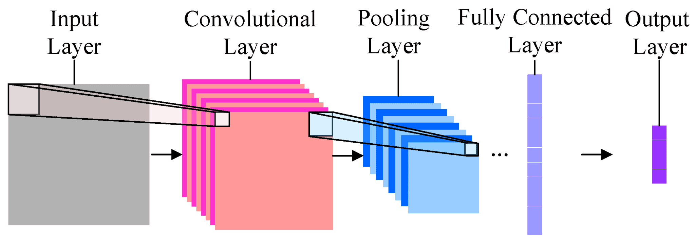 
  <em>Figure 2: Simplified diagram of the CNN architecture (Akshay Tondak)</em>

By restricting connections to local regions, CNNs present an inductive bias: they assume that neighboring pixels are more closely related than distant ones. While this assumption allows the architecture to capture spatial coherence with a smaller total parameter count, it can also become problematic for images requiring a more holistic view, such as in satellite imagery. CNNs also employ pooling layers that reduce the dimensionality of the input image as it propagates through the network. This allows for finer details to be captured by kernels early on in the network, and overarching semantic patterns to be detected by deeper layers (O'Shea, Keiron, and Ryan Nash).

### 2.3 Residual Networks

The primary drawback when employing traditional CNNs is the depth limitation encountered when attempting to add more layers. Deeper networks generally learn more complex features within images, but are also prone to suffering from optimization difficulties, including the degradation problem. This issue arises when increasing the number of layers, which causes the network to lose sight of the original input signal during backpropagation. Residual Networks (ResNets), introduced in the paper "Deep Residual Learning for Image Recognition" (He et al.), address this issue through the use of residual blocks. In this approach, the input sequence of a block of convolutional layers is added directly to the block's output via a skip connection (see Figure 3).

  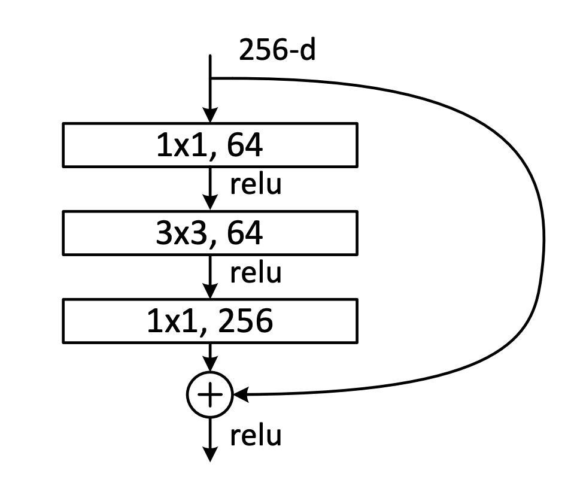 
  <em>Figure 3: Diagram of a bottleneck residual block used in ResNet-50, consisting of 3 stacked convolutional layers, a skip connection, and an activation function (He et al.)</em>

Instead of having to memorize the original image and transformation, this approach forces the network to only learn the residual mapping, which is the difference between the input and the desired output. As a result, the model can focus on refining the image to match the desired output at each convolution, rather than having to reconstruct it entirely from scratch and risking the original signal being lost. The main advantage ResNets possess over traditional CNNs is that they significantly extend representational capacity, allowing for more complex patterns to be memorized with minimal compromise of accuracy. It is for this reason that ResNets are considered more effective for modern tasks, and hence why they will be used as a primary comparator for this study.

### 2.4 Vision Transformers (ViT)

Vision Transformers (ViTs) are a novel type of deep learning architecture adapted from the transformer model introduced by Vaswani et al. in their paper "Attention Is All You Need" (Vaswani et al.). While the original transformer model was designed for natural language processing, the architecture would later be applied for image classification in the paper "An Image Is Worth 16x16 Words: Transformers for Image Recognition at Scale" (Dosovitskiy et al.).

In a ViT, the input image is first divided into equally sized patches, often 16x16 pixels with 3 color channels for RGB (see Figure 4). Each patch is then flattened into a vector and passed into a trained neural network to produce a token embedding. Conceptually, these embeddings attempt to encode a patch's most significant features, while also capturing their spatial position within the image. Then, a learnable classification token (CLS token) is prepended to the token embedding sequence, whose purpose is to act as a global representation of the image, and is used for the final classification.

<table align="center">
  <tr>
    <td align="center">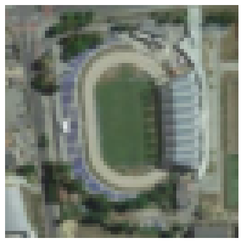 <em>(a) Input satellite image of a stadium 64x64</em></td>
    <td align="center">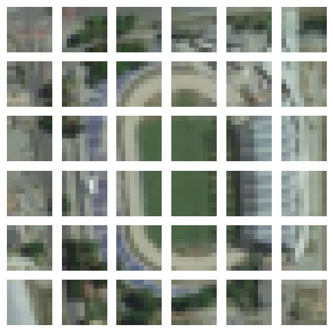 <em>(b) Image split into 10x10 patches</em></td>
  </tr>
</table>

<em>Figure 4: Sample visualization of an input image being split into patches before being processed by a ViT. Author's own.</em>

The core component of ViTs is the self-attention mechanism. In the self-attention head, patch embeddings are each transformed by a learned weight matrix, and then compared with all other patches to find how similar, or how much they 'attend' to, every other patch. Figure 5 shows the attention pattern found for an input image of a baseball field, with brightness corresponding to the strength of attention given to each patch. For this example, patches showing parts of a baseball field, such as the diamond, attend to other baseball field-related regions even if they are not spatially neighboring. These attention scores are then used to blend embeddings together, where a given patch's new embedding becomes a combination of all other patch embeddings, weighted by how much it attends to them. This allows the model to identify key regions that are related to each other, without being constrained to spatial proximity.

<table align="center">
  <tr>
    <td align="center">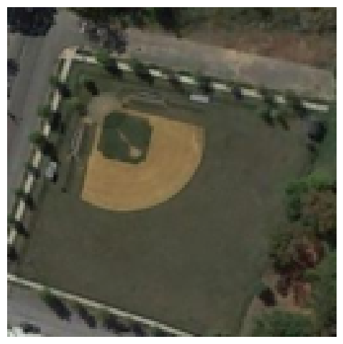 <em>(a) Input satellite image of a baseball field</em></td>
    <td align="center">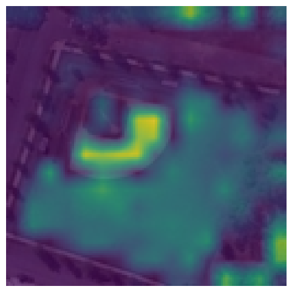 <em>(b) Final CLS attention pattern</em></td>
  </tr>
</table>

<em>Figure 5: Visualization of the final CLS attention pattern of an input image in a trained ViT-Small model. Author's own.</em>

Rather than using a single self-attention head, ViTs rely on multiple heads in parallel, each with their own trained weights representing their perspective on how patches should attend to each other. As the multi-head attention blocks update all vectors to add context, the previously mentioned CLS token accumulates global contextual information across layers. This now adapted CLS vector is fed into a neural network, where it is ultimately classified (Dosovitskiy et al.).

Unlike CNNs, which recognize features locally, ViTs excel at capturing long-range relationships between distant patches, which is particularly advantageous when distinguishing complex images that require a more holistic view. This architectural flexibility increases model capacity, but consequently demands greater training data and computational resources to effectively learn underlying patterns. For low-resolution satellite imagery, this architectural difference becomes especially relevant; a low-resolution input lacks both detail and requires a holistic approach, which bears a significant challenge for CV analysis. Whether global attention provides an advantage over localized relations becomes the basis of this investigation.

---

## 3 Methodology

  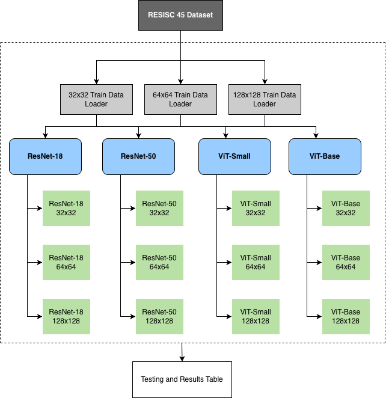 
  <em>Figure 8: Pipeline of methodology to be followed throughout the investigation. Author's own, created with Draw.io.</em>

### 3.1 Dataset

The selected dataset "RESISC45" is a publicly available collection of labeled remote sensing images. It was constructed in 2016 based on various online satellite image resources and serves as a useful benchmark for comparing CV models. The dataset contains 31,500 images, split between 45 scene categories (700 images per class) such as 'airport', 'basketball court', 'meadow', 'overpass', 'thermal power station', and more (Cheng et al.). RESISC45 was chosen due to its large number of data points that help prevent overfitting by exposing the selected architectures to a variety of heterogeneous landscapes, while remaining computationally manageable for the scope of this investigation. The dataset was obtained through the [Hugging Face datasets library](https://huggingface.co/datasets/timm/resisc45), which is a large repository of labeled data used for machine learning purposes. A sample of 15 images and labels from this dataset is displayed in Figure 9.

  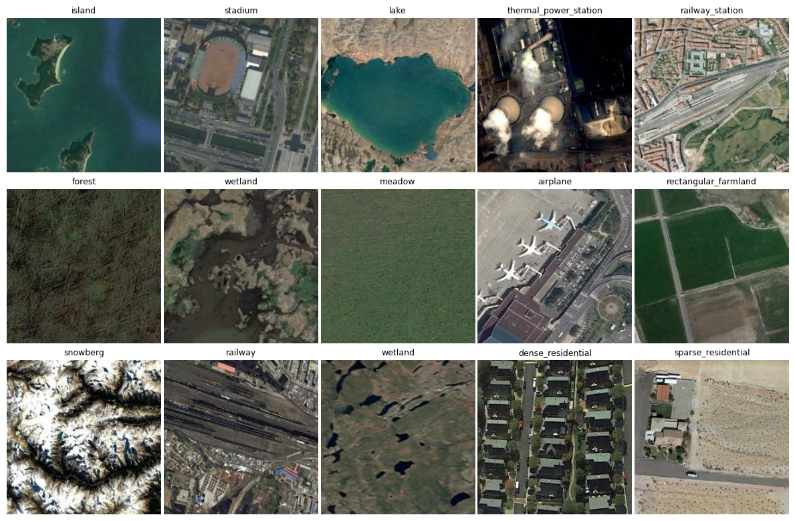 
  <em>Figure 9: Random sample of 15 images and their respective labels from the RESISC45 dataset. Author's own.</em>

For preprocessing, images in the dataset will first be resized from 256x256 pixels to 32x32, 64x64, and 128x128 pixels accordingly. Then, training images will be randomly rotated in order to augment their complexity, and then normalized to stabilize training. The full code for this procedure can be found in [`main.ipynb`](main.ipynb).

### 3.2 Model Architectures

Normal and smaller-sized models from each architecture family will be trained and evaluated in order to compare the performance of the architectures holistically, rather than relying on a single representative model. Furthermore, the two smaller variants will provide insight as to how model scaling affects overall performance for memory-constrained scenarios.

| Model Name | Num. of Parameters | Reason for choice | Source |
|---|---|---|---|
| ResNet18 | ~12 Million | Lightweight variant from the ResNet family comprising 9 residual blocks. | (He et al.) |
| ResNet50 | ~25 Million | Standard ResNet architecture, having 16 bottleneck blocks. | (He et al.) |
| ViT-Small | ~22 Million | Lightweight vision transformer architecture. Allows for comparison against ResNet18 while controlling for model size. | (Touvron et al.), DeiT-S with no distillation |
| ViT-Base | ~86 Million | Standard benchmark ViT model from Dosovitskiy et al. Provides insight into how 'normal-sized' transformers compare to ResNet50. | (Dosovitskiy et al.) |

<em>Table 1: Model selection table with model information</em>

Structural adjustments from the original architectures of the models will be required in order to adapt them for smaller resolutions. Vision Transformers were modified to split the images into 8x8 patches rather than 16x16 patches as in the original paper. This is because a larger patch size would not produce enough constituent patches to reveal underlying patterns. ResNets will also be modified to have a smaller spacing when sliding the kernel across the input image, as well as removing the initial pooling layer to avoid the images from shrinking too much early on and losing critical features.

### 3.3 Hyperparameters and Variables

Hyperparameters are external configuration variables set by the user to control the behavior of algorithms. Since this paper aims to compare the architectures' peak performance, hyperparameters will be fine-tuned through an initial training-validation process to identify the best-performing values for each family. These values will then be fixed during subsequent training, validation, and testing cycles across all image resolutions. Table 2 presents the optimal hyperparameters assigned for each family.

| Hyperparameter | What it controls | ResNet | ViT |
|---|---|---|---|
| Batch size | Number of training samples processed by a model before its internal parameters are updated. | 32 | 32 |
| Number of Epochs | The number of times a model trains on the same dataset. | 20 | 20 |
| Train/Val/Test Size | Ratio for which the dataset is split into training, validation, and testing sets. | 60:20:20 | 60:20:20 |
| Loss Function | The formula used to calculate the loss between predicted outputs and target values. | Cross-Entropy Loss | Cross-Entropy Loss |
| Label Smoothing | Modifies the calculated loss of a prediction by spreading the probability mass from the correct class to other incorrect classes by a given factor. This prevents the model from being overly confident in a single class prediction. | 0.1 | 0.1 |
| Optimizer | The algorithm that takes in loss values during training and determines how the model's parameters should be adjusted to minimize said loss through gradient descent. Different optimizers apply alternative approaches to determine the direction and magnitude of the next parameter adjustment. | Stochastic Gradient Descent with Momentum | AdamW |
| Learning Rate (LR) | A scalar factor that controls the size of the update step the optimizer takes with respect to all parameters when moving in the direction of the negative gradient of the loss. | 0.05 | 0.0001 |
| Weight Decay | A regularization technique applied to the optimizer that punishes large weight values, encouraging the model to capture general patterns rather than features specific to the training set. | 0.0001 | 0.05 |
| Scheduler | A module that can be implemented to gradually reduce the learning rate after each epoch. The scheduler can set the LR to follow any chosen function, but the most common is the cosine wave. | Cosine Annealing | Cosine Annealing |
| Dropout | A probability that forces certain modules of the model to 'deactivate' during training, in order to reduce the reliance one part of the network has on the rest. This regularization technique greatly reduces overfitting when working with smaller datasets. | None | NN in the decoder: 10% Attention weight matrix: 10% NN in the classification layer: 30% |

<em>Table 2: Hyperparameter Settings</em>

### 3.4 Evaluation Metrics

Models will first be evaluated based on training performance, where training and validation accuracy give insight as to how well the models progress relative to the set epochs. Accuracy is defined by how many correct image classifications were produced divided by the total number of images classified. Loss is also taken into consideration, measuring the difference between a model's predicted value and the true value for a given input.

Furthermore, precision, recall, and F1 score will be measured to evaluate classification performance. Precision measures how many of the images labeled as a landscape class are actually from that landscape class.

$$\text{Precision} = \frac{\text{True Positives (TP)}}{\text{True Positives (TP)} + \text{False Positives (FP)}}$$

Recall measures how many of the total images from a specific landscape were correctly labeled.

$$\text{Recall} = \frac{\text{True Positives (TP)}}{\text{True Positives (TP)} + \text{False Negatives (FN)}}$$

Lastly, the F1 score is the harmonic mean between precision and recall that combines both values into a single metric.

$$\text{F1 Score} = 2 \times \frac{\text{Precision} \times \text{Recall}}{\text{Precision} + \text{Recall}}$$

These metrics will be calculated across all image classes, and then combined using a weighted average to produce an overall performance score that accounts for class size imbalances (Grandini et al.).

### 3.5 Model Training

The four models will be trained on three variations of the dataset at different resolutions. All of the models will be trained with the specifications shown in Figure 10 (an NVIDIA A100-SXM4-40GB GPU), through the Google Colaboratory cloud service.

  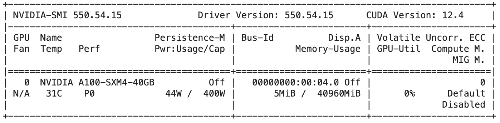 
  <em>Figure 10: Hardware specifications for model training on Google Colaboratory</em>

The full code to train and test each model across all resolutions can be found in [`main.ipynb`](main.ipynb).

### 3.6 Hypothesis

This study hypothesises that the ResNet architecture will outperform Vision Transformers at lower pixel resolutions (32x32 and 64x64) by leveraging inductive bias through local features such as edges and textures, while not requiring as much training data to achieve high results. However, at 128x128 pixels, the Vision Transformers are expected to benefit from enough contextual information for the attention mechanism to perform substantially better, even if training may take longer to reach a point of convergence.

---

## 4 Results and Analysis

### 4.1 Training Curves

  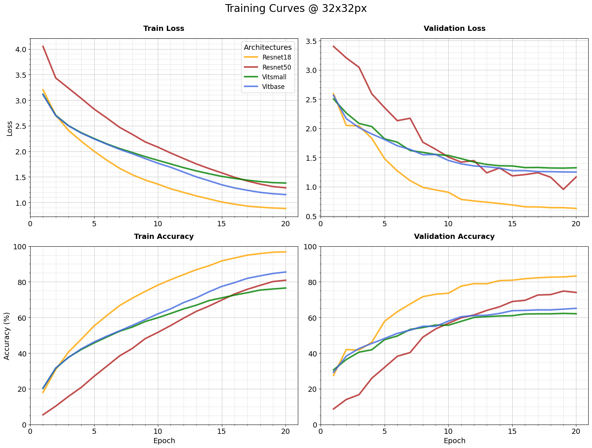 
  <em>Figure 11.a: Graph of training and validation results at 32x32 pixels. Author's own.</em>

  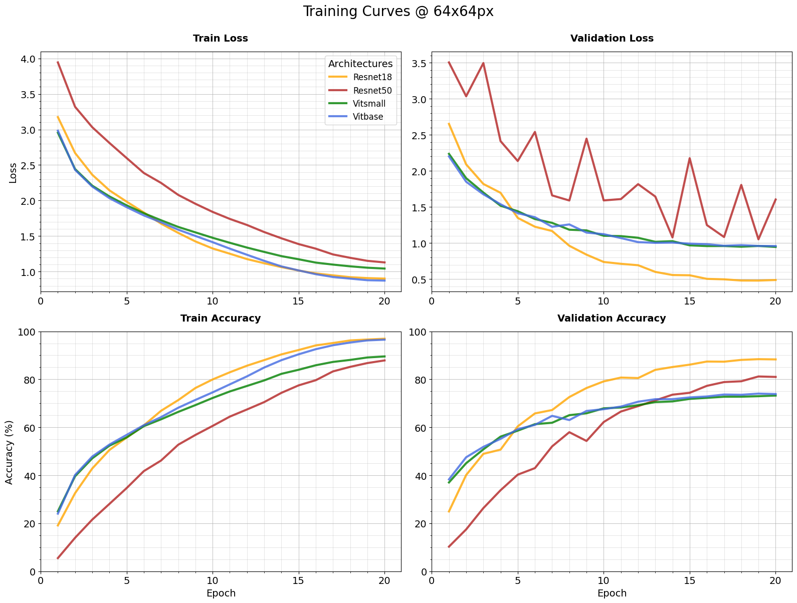 
  <em>Figure 11.b: Graph of training and validation results at 64x64 pixels. Author's own.</em>

  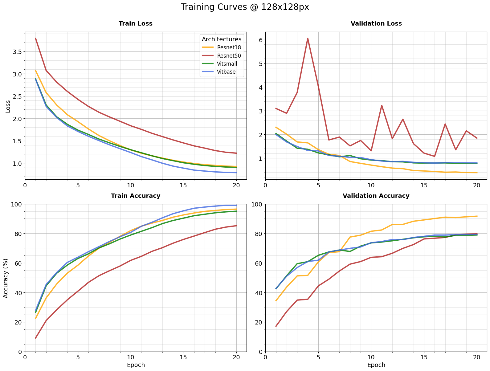 
  <em>Figure 11.c: Graph of training and validation results at 128x128 pixels. Author's own.</em>

### 4.2 Testing Results

  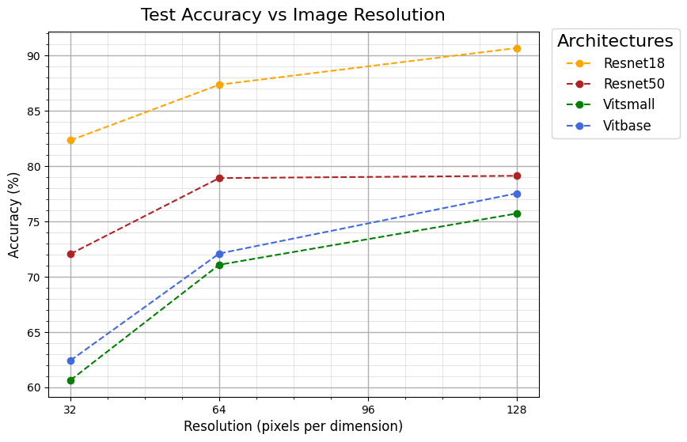 
  <em>Figure 12: Graph of Testing results across all resolutions. Author's own.</em>

| Model | Resolution | Loss | Accuracy (%) | Precision | Recall | F1 |
|---|---|---:|---:|---:|---:|---:|
| ResNet18 | 32x32 | 0.666 | 82.33 | 0.824 | 0.823 | 0.822 |
| ResNet18 | 64x64 | 0.519 | 87.37 | 0.874 | 0.874 | 0.873 |
| ResNet18 | 128x128 | 0.430 | **90.68** | 0.908 | 0.907 | 0.907 |
| ResNet50 | 32x32 | 1.071 | 72.06 | 0.722 | 0.721 | 0.718 |
| ResNet50 | 64x64 | 0.977 | 78.92 | 0.790 | 0.789 | 0.788 |
| ResNet50 | 128x128 | 2.152 | 79.13 | 0.795 | 0.791 | 0.791 |
| ViT-Small | 32x32 | 1.387 | 60.65 | 0.610 | 0.607 | 0.603 |
| ViT-Small | 64x64 | 1.033 | 71.08 | 0.714 | 0.711 | 0.709 |
| ViT-Small | 128x128 | 0.885 | 75.71 | 0.760 | 0.757 | 0.756 |
| ViT-Base | 32x32 | 1.340 | 62.43 | 0.623 | 0.624 | 0.622 |
| ViT-Base | 64x64 | 1.029 | 72.10 | 0.723 | 0.721 | 0.720 |
| ViT-Base | 128x128 | 0.899 | 77.54 | 0.776 | 0.775 | 0.774 |

<em>Table 3: Quantitative testing results.</em>

### 4.3 Performance Results

| Model | Resolution | Training Time (s) | Avg. Inference Time / image (ms) |
|---|---|---:|---:|
| ResNet18 | 32x32 | 307 | 1.681 |
| ResNet18 | 64x64 | 353 | 3.994 |
| ResNet18 | 128x128 | 687 | 13.433 |
| ResNet50 | 32x32 | 354 | 4.150 |
| ResNet50 | 64x64 | 609 | 13.128 |
| ResNet50 | 128x128 | 2087 | 61.769 |
| ViT-Small | 32x32 | 455 | 1.994 |
| ViT-Small | 64x64 | 475 | 5.630 |
| ViT-Small | 128x128 | 1305 | 22.175 |
| ViT-Base | 32x32 | 499 | 5.560 |
| ViT-Base | 64x64 | 1077 | 17.946 |
| ViT-Base | 128x128 | 3952 | 78.278 |

<em>Table 4: Quantitative performance results.</em>

### 4.4 Analysis

By inspecting the training graphs, a strong relationship between increasing the image resolution and a higher training and validation accuracy is apparent across all models. Unsurprisingly, more spatial information gave models additional context and features to extract, naturally improving their accuracy.

Among all image resolutions, ResNet18 achieved the highest testing and validation accuracy, indicating its robustness amidst low spatial detail (Figure 11). The model's low inference time of 1.7 milliseconds makes it the strongest contender for real-world deployment, where computational efficiency is just as valuable as output quality (Table 4). Evaluating ResNet50, it performs substantially worse, despite having twice the number of parameters and a larger capacity to learn intrinsic patterns (see Table 1). The lack of input information in lower resolution images limits ResNet50's ability to take advantage of its depth, forcing it to memorize narrow patterns specific to individual images, rather than the broader relationships present within each class. This phenomenon, known as overfitting, accounts for the observed performance difference, proving that a larger model does not necessarily translate to better performance (Ying, Xue).

On the other hand, the ViT models had the lowest overall performance, but benefited the most from resolution increases. This trend is aligned with the testing results, where ViT-S and ViT-B both showed a 15.1% rise in accuracy across the full pixel range, whereas ResNet18 and ResNet50 only benefited by 8.4% and 7.1% in accuracy, respectively (Table 3). This gap suggests that the transformer architecture capitalizes more from additional spatial detail, likely due to its weak inductive bias in prioritizing global relationships. In contrast, ResNets gain less from enhanced spatial detail due to their hierarchical feature extraction system, where local patterns are effectively captured early in the network, making additional resolution less impactful for improved classification performance. With regards to efficiency, ViT-Base's additional 60 million parameters do not translate into higher accuracy, as its inference time increases to ~78 milliseconds significantly, making it less apt for satellite image analysis given the used hardware (Table 4).

Both ViT models see an exponential improvement in accuracy and loss between epochs 0-5, with improvements plateauing thereafter (Figure 11). This contradicts my initial hypothesis, which predicted that the architecture would see an increase in performance at later epochs, suggesting there isn't enough image diversity for the models to make use of their size.

Interestingly, while both ViT models had nearly adjacent validation results across all resolutions, ViT-Base performed substantially better on the training sets. This is consistent with the tendency of larger models to overfit: they perform highly on memorized training data, but see no improvement on unseen validation samples. This behavior is evident at 128x128 pixels, where ViT-Base attains an unreasonably high 100% accuracy on the training set, but only achieves 77.5% on the test set.

The strangest observation within the training graphs arises from ResNet50's fluctuating behavior in validation loss. As the resolution increases towards 64 and 128 pixels, the model's validation loss jumps erratically, heavily penalizing validation accuracy. Given that precision, recall, and F1 scores for ResNet50 are stable across all resolutions and models (Table 3), the possibility of a dataset issue, such as class imbalances, can be negated. One feasible explanation could be that at higher resolutions, ResNet50's deeper architecture attempts to exploit finer details, making it more sensitive to noise and brighter pixel values that negatively impact the confidence scores, and hence the loss. Nevertheless, the spikes could also be attributed to suboptimal hyperparameter tuning.

---

## 5 Conclusion

This investigation aimed to apply the theoretical foundations behind the ResNet and ViT architectures, as well as an experimental methodology, to evaluate the performance of these models under low-resolution image inputs and real-world conditions. As hypothesized, it was found that the ResNet family outperformed ViT models across all evaluation metrics by utilizing the architecture's inductive bias towards local features. ResNet18 proved to be the most efficient model, boasting the highest testing accuracy across 32, 64, and 128 pixel resolution images while performing at the lowest inference time of 1.7 milliseconds. This makes ResNet18 particularly well-suited for processing terabytes of satellite imagery, while still being time and cost-effective during training. Nevertheless, ViTs demonstrated significant accuracy gains with increased resolution while rapidly learning critical features within a few epochs, suggesting their suitability for larger input sizes. Overall, this study has proven that ResNets are more efficient for low-resolution use cases, while ViTs could be viable if provided more data at higher resolutions.

---

## 6 Further Scope

### 6.1 Limitations and Challenges

This investigation could have been more sophisticated had the models been trained on a larger dataset. Some of the pitfalls in the ViTs' performance stem from the insufficient number of data points provided to create accurate generalizations. Regardless, the fact that ViTs require a larger dataset to perform well is a limitation within itself, proving that the architecture is more demanding and less adaptable in data-constrained environments. Additionally, hyperparameter tuning may not have been optimal, as seen with the fluctuations in ResNet50 training and validation across training graphs. Finding the optimal values for hyperparameters is a task that requires significant time, analysis, and GPU compute, which, for this investigation, were limited.

### 6.2 Areas for Further Investigation

Due to the rapidly evolving nature of AI, data scientists are continuously developing newer architectures that aim to solve CV tasks faster. Notably, data-efficient image transformers (DeiT) proposed by Touvron, Hugo, et al. adapt ViTs to achieve competitive performance with limited computational resources and training data points. Although this investigation only compared two representative models from the ResNet and ViT families, the release of these newer models suggests there is still plenty of room for further comparisons. Furthermore, evaluating these models pre-trained on massive datasets could be a possible extension, as the accessibility of large databases has led pre-training to become more common amongst industry-related applications.

---

## 7 Bibliography

- Akshay Tondak. "Convolutional Neural Network (CNN) | Azure Machine Learning." *K21 Academy*, 23 Aug. 2022, [k21academy.com/microsoft-azure/convolutional-neural-network/](https://k21academy.com/microsoft-azure/convolutional-neural-network/).
- Cheng et al. "Remote Sensing Image Scene Classification: Benchmark and State of the Art." *Proceedings of the IEEE*, vol. 105, no. 10, 3 Apr. 2017, pp. 1865–1883, [arxiv.org/abs/1703.00121](https://arxiv.org/abs/1703.00121), <https://doi.org/10.1109/jproc.2017.2675998>.
- Dosovitskiy, Alexey, et al. "An Image Is Worth 16x16 Words: Transformers for Image Recognition at Scale." *ArXiv.org*, 2020, [arxiv.org/abs/2010.11929](https://arxiv.org/abs/2010.11929).
- Grandini, Margherita, et al. "Metrics for Multi-Class Classification: An Overview." *ArXiv.org*, 2020, [arxiv.org/abs/2008.05756](https://arxiv.org/abs/2008.05756).
- He, Kaiming, et al. "Deep Residual Learning for Image Recognition." *ArXiv.org*, 2015, [arxiv.org/abs/1512.03385](https://arxiv.org/abs/1512.03385).
- Henry, A., E. Daniel, S. Seetha, and S. Durga. "Bridging CNNs and Transformers: A Comparative Study of EfficientNet, ResNet, and ViT for Plant Disease Detection." *2025 6th International Conference on Data Intelligence and Cognitive Informatics (ICDICI)*, IEEE, 2025, pp. 718–724. doi:10.1109/ICDICI66477.2025.11135138.
- Hugging Face. "Visualize Attention Map for Vision Transformer · Huggingface/Pytorch-Image-Models · Discussion #1232." *GitHub*, 25 Apr. 2022, [github.com/huggingface/pytorch-image-models/discussions/1232](https://github.com/huggingface/pytorch-image-models/discussions/1232).
- Murali, Kaushik, et al. *A Comparative Study of CNN, ResNet, and Vision Transformers for Multi-Classification of Chest Diseases.* arXiv, 2024, arXiv:2406.00237v1.
- O'Shea, Keiron, and Ryan Nash. *An Introduction to Convolutional Neural Networks*, 2 Dec. 2015, <https://arxiv.org/abs/1511.08458>.
- Sedighkia, Mahdi, and Bithin Datta. "Predicting Impact of Land Cover Change on Flood Peak Using Hybrid Machine Learning Models." *Neural Computing and Applications*, vol. 35, no. 9, 28 Nov. 2022, pp. 6723–6736, <https://doi.org/10.1007/s00521-022-08070-y>.
- Shruti Jadon. "Introduction to Different Activation Functions for Deep Learning." *Medium*, 16 Mar. 2018, [medium.com/@shrutijadon/survey-on-activation-functions-for-deep-learning-9689331ba092](https://medium.com/@shrutijadon/survey-on-activation-functions-for-deep-learning-9689331ba092).
- Stanimirova, Radost, Michelle Sims, Anton Raichuk, and Maxim Neumann. "New Data on GFW Provides the Most Detailed Look Yet of What's Driving Forest Loss Globally." *Global Forest Watch*, 21 May 2025, <https://www.globalforestwatch.org/blog/data-and-tools/new-drivers-data-forest-loss/>.
- Touvron, Hugo, et al. "Training Data-Efficient Image Transformers & Distillation through Attention." *ArXiv.org*, 2020, [arxiv.org/abs/2012.12877](https://arxiv.org/abs/2012.12877).
- Vaswani, Ashish, et al. "Attention Is All You Need." *ArXiv.org*, 2017, [arxiv.org/abs/1706.03762](https://arxiv.org/abs/1706.03762).
- Ying, Xue. "An Overview of Overfitting and Its Solutions." *Journal of Physics: Conference Series*, vol. 1168, Feb. 2019, p. 022022, <https://doi.org/10.1088/1742-6596/1168/2/022022>.

---

## Running the Code

All code lives in [`main.ipynb`](main.ipynb):

1. **Training (Google Colab, GPU):** the first part of the notebook builds the RESISC45 dataloaders at 32/64/128 px, trains all four models, and saves each model + its training history to Google Drive as `ViT-CNN-Results/{model}-{px}_results.pth`.
2. **Evaluation (local):** the *Model Testing and Evaluation* section loads those `.pth` files from a local `ViT-CNN-Results/` folder, evaluates every model on the test set, plots the training curves and accuracy-vs-resolution graph, writes [`performance_table.csv`](performance_table.csv), and visualizes ViT attention maps.

**Requirements:** `torch`, `torchvision`, `datasets`, `torcheval`, `torchinfo`, `matplotlib`, `seaborn`, `pandas`, `numpy`.

> **Note:** the trained model files (`ViT-CNN-Results/`, ~1.6 GB) are not included in this repository due to GitHub's file size limits.
